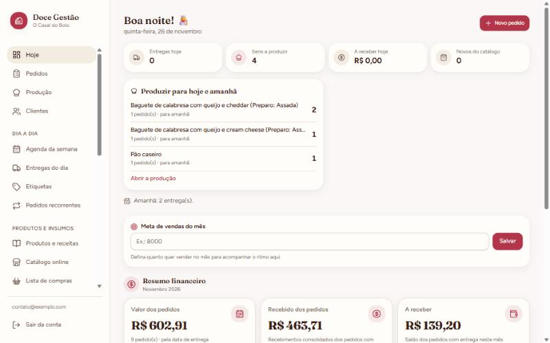
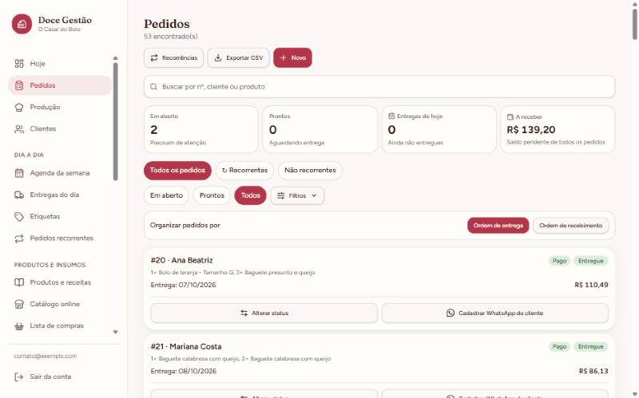
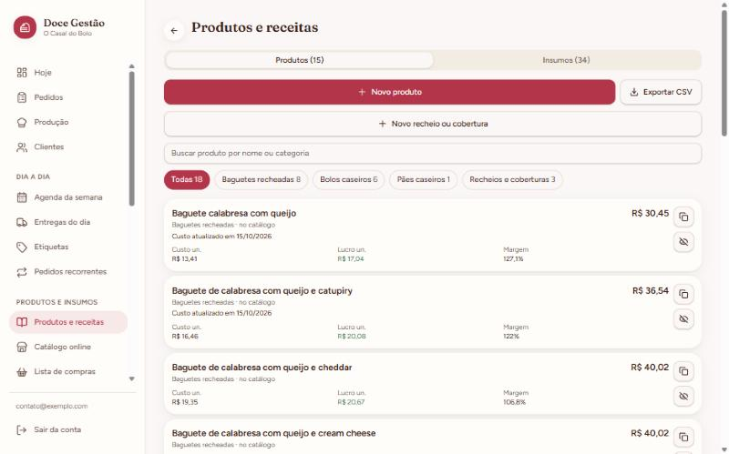
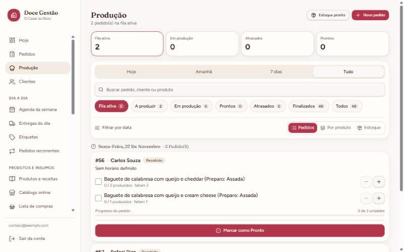

# Doce Gestão

Sistema online (SaaS) de gestão para **confeitarias**: pedidos, produção, receitas com custo
real, estoque, compras, financeiro e um **catálogo online com Pix** para o cliente pedir
sozinho. Em português, pensado para usar no celular.

**Demonstração:** https://minhaconfeitaria.lovable.app


<table>
  <tr>
    <td><br><sub><b>Painel do dia</b>: entregas, o que produzir e resumo do mês</sub></td>
    <td><br><sub><b>Pedidos</b>: status de pagamento e de entrega</sub></td>
  </tr>
  <tr>
    <td><br><sub><b>Produtos e receitas</b>: custo, lucro e margem de cada item</sub></td>
    <td><br><sub><b>Produção</b>: fila do dia com progresso por pedido</sub></td>
  </tr>
</table>

<sub>Telas de uma conta real, com nomes de clientes, contatos e valores trocados por dados fictícios.</sub>

---

## O problema que resolve

- Pedidos anotados no WhatsApp e no caderno, com **encomenda esquecida** ou entregue errada.
- Preço do bolo **"no chute"**, sem saber o custo dos ingredientes nem o lucro de cada venda.
- Ingrediente acabando no meio da produção.
- Dinheiro de pedido, sinal e despesa misturados, sem saber **quanto sobrou no mês**.

## Funções

**Vendas**
- **Pedidos** com entrega/retirada, sinal, recebimentos parciais e acompanhamento por link curto.
- **Catálogo online** com a marca da confeitaria, pagamento por **Pix**, taxa de entrega por bairro, cupons, programa de **fidelidade**, encomendas personalizadas com foto de referência e **avaliações** dos clientes.
- **Pedido por mensagem com IA**: cola o texto do WhatsApp e o sistema monta o pedido para revisar.
- **Clientes** com histórico de compras.

**Produção e custos**
- **Receitas** com custo calculado pelo preço real de cada ingrediente, incluindo recheios e coberturas.
- **Produção do dia**, agenda da semana, lista de compras e rota de entrega.
- **Etiquetas** para imprimir, com validade e alergênicos.

**Estoque e compras**
- Estoque de ingredientes e de **produtos prontos**.
- **Importação de nota fiscal** (DANFE e NFC-e em PDF ou foto), lida no próprio navegador, com vínculo aos ingredientes.

**Financeiro**
- Recebimentos, despesas e **despesas fixas mensais** lançadas sozinhas.
- Fluxo de caixa, meta de vendas do mês e lucro por pedido, que não muda quando o preço do fornecedor muda.

**Equipe e plataforma**
- Equipe com perfis (gerente e produção, que não vê o financeiro).
- Aplicativo instalável no celular (PWA) com **aviso de pedido novo**.
- **Painel da plataforma** (site separado) para quem vende o sistema: empresas, planos, assinaturas e monitoramento de erros.
- Integração com **assistentes de IA (MCP)** em modo só leitura.

## Segurança e LGPD

- Cada confeitaria só enxerga os próprios dados. O isolamento é garantido **no banco de dados** (Row Level Security), não só na tela.
- O visitante do catálogo não lê nenhuma tabela: preço, frete e custo são calculados no servidor.
- Testes automáticos em SQL garantem essas regras a cada mudança (`tests/db/`).

## Detalhes técnicos

O repositório contém dois aplicativos:

| Aplicativo | Onde fica | O que é |
|---|---|---|
| Sistema da confeitaria | raiz (`src/`) | App usado pelas confeitarias e pelo catálogo público dos clientes |
| Painel de administração da plataforma | `admin/` | Site separado (Vite estático, publicado no GitHub Pages) para quem vende o sistema: empresas, planos, assinaturas e erros |

Domínio próprio ainda não configurado; ver `docs/checklist-lancamento-comercial.md`.

## Tecnologias

- TanStack Start + TanStack Router e Query, React 19, TypeScript, Tailwind CSS 4, componentes shadcn/ui.
- Banco e autenticação: Supabase (PostgreSQL com RLS), hospedado no Lovable Cloud.
- Migrações SQL em `drizzle/migrations/` (arquivos numerados, ver `docs/operacao/migracoes.md`).
- Testes: Vitest (`src/**/*.test.ts`) e testes de fumaça em SQL (`tests/db/`).
- Gerenciador de pacotes: Bun (`bun.lock`).
- O projeto é sincronizado com o Lovable: o que entra em `main` aparece no editor deles.

## Como rodar localmente

Requisitos: [Bun](https://bun.sh) e um projeto Supabase de **desenvolvimento** (nunca use o de produção).

```sh
bun install
cp .env.example .env     # preencha com os dados do projeto de desenvolvimento
bun run dev
```

## Comandos

| Comando | Para quê |
|---|---|
| `bun run dev` | Servidor de desenvolvimento |
| `bun run build` | Build de produção do sistema |
| `bunx vite build --config admin/vite.config.ts` | Build do painel de administração |
| `bun run test` | Testes unitários (Vitest) |
| `bun run lint` | Lint (ESLint) |
| `bunx tsc --noEmit` | Checagem de tipos |
| `bun run format` | Formata o código (Prettier) |

O CI (`.github/workflows/quality.yml`) roda lint, tipos, testes, build dos dois aplicativos e, em um PostgreSQL descartável, aplica todas as migrações e executa os testes de `tests/db/`. Um PR só é mesclado automaticamente depois que todos os checks passam.

## Estrutura

```
src/routes/            Telas e rotas (privadas em _authenticated/, catálogo público em $slug, c.$slug, p.$codigo)
src/components/        Componentes (app/ = do sistema, ui/ = base shadcn)
src/lib/               Regras de negócio puras e testadas (custos, financeiro, gestão, catálogo, planos…)
src/integrations/      Cliente Supabase e middlewares de autenticação
admin/                 Painel de administração da plataforma
drizzle/migrations/    Migrações do banco (fonte usada pelo CI)
supabase/migrations/   Migrações antigas aplicadas por outro caminho (histórico)
tests/db/              Testes de fumaça em SQL (isolamento, catálogo, financeiro, estoque…)
docs/                  Documentação (índice abaixo)
```

## Documentação

- `docs/arquitetura.md` — visão geral, modelo multiempresa, segurança e decisões importantes.
- `docs/operacao/` — procedimentos: backup e restauração, migrações, resposta a incidentes.
- `docs/checklist-lancamento-comercial.md` — o que falta para vender, com responsável e situação.
- `docs/avaliacao-comercial-e-piloto.md` — avaliação de prontidão e critérios do piloto.
- `docs/auditoria-e-plano-de-melhorias.md` — auditoria técnica (etapas A–H).
- `docs/formulas-financeiras.md` — fórmulas de contas a pagar.
- `docs/deploy/` — guias de implantação de migrações específicas.
- `AGENTS.md` — regras de desenvolvimento do projeto (também seguidas por ferramentas de IA).
- `SECURITY.md` — como reportar vulnerabilidades.
- `CHANGELOG.md` — histórico de mudanças.

## Regras que não podem ser quebradas

As principais estão em `AGENTS.md`. Em resumo: toda tabela tem RLS por confeitaria; o visitante anônimo nunca lê tabelas (só funções específicas do catálogo); preços e custos do catálogo são calculados no servidor; recebimentos só mudam por funções próprias; custos gravados em pedidos antigos nunca são recalculados. Os testes de `tests/db/` garantem essas regras e devem continuar passando.

## Contribuindo

1. Crie um branch a partir de `main` (não reescreva histórico já publicado: o repositório é sincronizado com o Lovable).
2. Faça a mudança com testes. Mudança de banco = nova migração numerada + teste em `tests/db/` quando tocar em regra de dados.
3. Abra um PR. O CI precisa passar. Não coloque segredos no repositório.

---

Desenvolvido por **Dennys** · [github.com/densaymmon](https://github.com/densaymmon)
